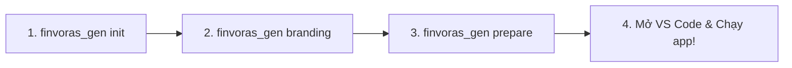

# FinvorasGen 🚀

**FinvorasGen** là bộ công cụ CLI nội bộ dành cho đội ngũ phát triển Flutter tại **Finvoras**, hỗ trợ tự động hóa toàn bộ vòng đời phát triển ứng dụng:
- 🏗 **Khởi tạo dự án chuẩn** monorepo & tích hợp bộ thư viện cốt lõi (`packages/`).
- 🎨 **Setup Branding & Flavors** (`dev`, `qa`, `prod`, launcher icons, splash screen, native signing).
- ⚙️ **One-shot Bootstrap & Prepare** (`lib/main.dart`, `app.dart`, `di.dart`, `prepare_environment.dart`, `.vscode/launch.json`).
- 📦 **Sinh mã Type-Safe** cho Assets (Images, SVG, Lottie, Rive), Colors, Fonts và Đa ngôn ngữ (Locales/i18n).
- 🚀 **Tự động hóa CI/CD Deployment** với Fastlane cho Android & iOS.

---

## 📋 Yêu cầu tiên quyết (Prerequisites)

Trước khi cài đặt và sử dụng, đảm bảo máy tính của bạn đã có:

1. **Dart SDK >= 3.6.0** & **Flutter SDK** (hoặc [FVM](https://fvm.app/)).
2. **Git & Quyền truy cập**: Đã cấu hình SSH Key hoặc Personal Access Token có quyền truy cập repo:
   - Repo công cụ: `https://github.com/hoangsang17th/finvoras_gen`
   - Repo thư viện chung: `https://github.com/hoangsang17th/packages`
3. **PATH Environment**: Đảm bảo đường dẫn `~/.pub-cache/bin` đã được thêm vào PATH hệ thống (trong `~/.zshrc` hoặc `~/.bashrc`):
   ```sh
   export PATH="$PATH":"$HOME/.pub-cache/bin"
   ```

---

## 🛠 Cài đặt & Cập nhật (Team Setup)

Công cụ được lưu hành nội bộ qua Git private repository. Thành viên trong team cài đặt trực tiếp qua `dart pub global`:

### Cài đặt lần đầu
```sh
dart pub global activate --source git https://github.com/hoangsang17th/finvoras_gen.git
```
*(Nếu bạn cấu hình Git qua SSH, có thể dùng: `dart pub global activate --source git git@github.com:hoangsang17th/finvoras_gen.git`)*

### Cập nhật khi có phiên bản mới
Mỗi khi có cập nhật mới trên nhánh `main`, chỉ cần chạy lại lệnh cài đặt:
```sh
dart pub global activate --source git https://github.com/hoangsang17th/finvoras_gen.git
finvoras_gen version
```

### Chạy từ source cục bộ (Dành cho Core Maintainer)
```sh
cd finvoras_gen
dart pub global activate --source path .
```

---

## 🚦 Quy trình chuẩn khi tạo & thiết lập ứng dụng mới



```sh
# 1. Khởi tạo app và kéo packages chuẩn
finvoras_gen init vn.com.finvoras.my_app --app-name "My App"
cd my_app

# 2. Cấu hình đa môi trường (dev, qa, prod), splash và icon
finvoras_gen branding --envs dev,qa,prod --app-name "My App"

# 3. Bootstrap toàn bộ mã nguồn core, DI, routing và VS Code profiles
finvoras_gen prepare -r flutter --workspace all --yes
```

---

## 📖 Chi tiết các lệnh (Command Reference)

### 1. `init` — Khởi tạo dự án Flutter chuẩn

Khởi tạo cấu trúc dự án Flutter mới tích hợp bộ submodule `packages/` và các cấu hình monorepo chuẩn mực.

```sh
finvoras_gen init <app-id> [options]

# Ví dụ
finvoras_gen init vn.com.finvoras.myapp --app-name "My Super App"
```

**Các tham số (Options):**

| Flag | Viết tắt | Mặc định | Mô tả |
|---|---|---|---|
| `--app-name` | `-n` | Auto format từ ID | Tên hiển thị của app trên iOS/Android (VD: `"Finvoras Hub"`) |
| `--packages-path` | `-p` | `null` | Đường dẫn tới thư mục `packages` cục bộ (hữu ích khi làm việc offline hoặc dev monorepo) |

**Các bước tự động thực hiện:**
1. Tạo Flutter app với `--org` và project name trích xuất từ `<app-id>`.
2. Tải bộ thư viện `packages/` (thử clone từ GitHub, nếu offline sẽ tìm kiếm từ `--packages-path`, biến môi trường `FINVORAS_PACKAGES_PATH`, hoặc các thư mục `packages` lân cận).
3. Chuẩn hóa `pubspec.yaml`: Liên kết workspace packages, khai báo `finvoras_gen`, `melos.scripts`, thêm bộ thư viện chuẩn (`injectable`, `get_it`, `firebase_core`, `flutter_easyloading`,...).
4. Thiết lập cấu hình `.vscode/launch.json` và `.vscode/settings.json`.
5. Đồng bộ `ios/Podfile` lên platform `15.0`.
6. Chạy `flutter pub get` và `pod install --repo-update` trên macOS.

---

### 2. `prepare` — Monorepo One-Shot Bootstrap

Thiết lập toàn bộ khung mã nguồn khởi động cho dự án monorepo (Core bootstrapping, DI, Environment, Routing placeholder).

```sh
# Sử dụng Flutter SDK mặc định
finvoras_gen prepare

# Chỉ định sử dụng FVM và chạy non-interactive
finvoras_gen prepare --runtime fvm --workspace all --yes
```

**Các tham số (Options):**

| Flag | Viết tắt | Mặc định | Mô tả |
|---|---|---|---|
| `--runtime` | `-r` | `flutter` | Runtime thực thi: `flutter` hoặc `fvm` |
| `--workspace` | `-w` | `all` | Workspace mục tiêu: `all`, `root`, hoặc danh sách `packages/a,packages/b` |
| `--yes` | `-y` | `false` | Bỏ qua các bước xác nhận thủ công (phù hợp chạy CI/Script) |

**Tự động sinh các file quan trọng:**
- `lib/main.dart`: Entrypoint chính.
- `lib/app.dart`: Khởi tạo ứng dụng với `AppOrchestrator`, App theme, route observer, Firebase.
- `lib/core/configs/di.dart`: Cấu hình Dependency Injection (`get_it`, `injectable`).
- `lib/core/configs/prepare_environment.dart`: Pipeline chuẩn bị môi trường runtime an toàn.
- `lib/core/configs/app_keys.dart`: Khai báo Global Keys.
- `.vscode/launch.json`: Cấu hình sẵn các profile chạy Debug / Profile / Release.

---

### 3. `branding` — Setup Flavors, Native Splash & App Icons

Cấu hình flavors cho đa môi trường, icon ứng dụng và splash screen theo tiêu chuẩn Production.

```sh
# Mặc định: 3 môi trường dev, qa, prod (Behavior mode)
finvoras_gen branding

# Tùy biến môi trường và logo
finvoras_gen branding --envs dev,staging,prod --logo assets/images/my_logo.png --app-name "My App"

# Platform mode: mỗi flavor có Application ID riêng (thêm suffix .<env>)
finvoras_gen branding --type platform --envs dev,stg,prod

# Chế độ CI: không hỏi xác nhận
finvoras_gen branding --yes
```

**Các tham số (Options):**

| Flag | Viết tắt | Mặc định | Mô tả |
|---|---|---|---|
| `--type` | `-t` | `behavior` | `behavior` (dùng chung App ID) hoặc `platform` (mỗi môi trường 1 App ID) |
| `--envs` | `-e` | `dev,qa,prod` | Danh sách các môi trường, phân cách bởi dấu phẩy |
| `--logo` | | `assets/images/logo.png` | Đường dẫn tới file ảnh logo nguồn |
| `--app-name` | `-n` | Auto | Tên hiển thị ứng dụng |
| `--yes` | `-y` | `false` | Chạy không cần tương tác bàn phím |
| `--dry-run` | | `false` | Xem trước các thay đổi mà không ghi vào file |

**Tính năng nâng cao:**
- Tự động sinh `flutter_native_splash-<env>.yaml` & `flutter_launcher_icons-<env>.yaml`.
- Tự động cấu hình signing cấu hình Release trong `android/app/build.gradle`.
- Tự động đồng bộ các file launch configuration trong `.vscode/launch.json` cho từng flavor (`dev Debug`, `prod Release`,...).

---

### 4. `assets` — Sinh mã Type-Safe cho Assets, Fonts, Colors & Locales

Sinh mã nguồn Dart type-safe dựa trên khai báo trong `pubspec.yaml`.

```sh
# Chạy với pubspec.yaml mặc định
finvoras_gen assets
# (hoặc gõ tắt: finvoras_gen)

# Chỉ định file pubspec hoặc build.yaml tùy chỉnh
finvoras_gen assets -c path/to/pubspec.yaml
finvoras_gen assets -c pubspec.yaml -b build.yaml
```

**Thành phần sinh ra:**
- `assets.gen.dart`: Truy cập tài nguyên type-safe (`AppAssets.images.logo.image(...)`, `AppAssets.icons.home.svg(...)`). Hỗ trợ SVG, Lottie, Rive.
- `colors.gen.dart`: Mã màu từ XML / Asset colors.
- `fonts.gen.dart`: Family font type-safe.
- `locales.gen.dart`: Đa ngôn ngữ i18n (`AppLocalesKeys.greeting.tr`).

---

### 5. `fastlane` — Thiết lập Pipeline Deploy tự động

Tự động thiết lập hạ tầng Fastlane cho Android và iOS với các lanes chuẩn hóa.

```sh
finvoras_gen fastlane
```

**Các lane chuẩn được tạo sẵn trong `Fastfile`:**
- `increment_version`: Tự động tăng build number trong `pubspec.yaml` đồng bộ cho cả Android/iOS.
- `deploy`: Build và upload lên Google Play Store (`internal track`) hoặc TestFlight.
- `production`: Build và upload bản phát hành chính thức lên Google Play / App Store.
- `beta`: Build và upload lên Firebase App Distribution.

---

### 6. Các lệnh tiện ích khác

- **`refresh`**: Dọn dẹp cache và kéo lại dependencies (tương đương `flutter clean && flutter pub get`):
  ```sh
  finvoras_gen refresh
  ```
- **`version`**: Kiểm tra phiên bản CLI đang cài:
  ```sh
  finvoras_gen version
  # hoặc
  finvoras_gen -v
  ```

---

## ⚙️ Cấu hình chuẩn trong `pubspec.yaml`

Cấu hình mẫu được tích hợp trong dự án:

```yaml
finvoras_gen:
  app_id: vn.com.finvoras.myapp
  app_name: My App
  output: lib/generated/
  line_length: 80
  assets:
    enabled: true
    outputs:
      class_name: AppAssets
  locales:
    enabled: true
    folder: assets/locales
    outputs:
      translation_name: AppTranslation
      keys_name: AppLocalesKeys
  integrations:
    flutter_svg: true
    lottie: true
```

---

## ❓ Xử lý sự cố thường gặp (Troubleshooting)

### 1. Lỗi `command not found: finvoras_gen`
- **Nguyên nhân**: Thư mục cache binary của pub chưa có trong biến môi trường `$PATH`.
- **Cách khắc phục**: Mở file `~/.zshrc` (hoặc `~/.bashrc`), thêm dòng sau vào cuối file rồi restart terminal:
  ```sh
  export PATH="$PATH":"$HOME/.pub-cache/bin"
  ```

### 2. Lỗi quyền truy cập khi `init` kéo `packages` (Permission denied / Git clone error)
- **Nguyên nhân**: Máy tính chưa cấu hình SSH Key hoặc Personal Access Token có quyền truy cập repo `https://github.com/hoangsang17th/packages`.
- **Cách khắc phục**:
  - Cách 1: Thiết lập SSH Key trên tài khoản GitHub của bạn.
  - Cách 2: Nếu làm việc offline hoặc đã có thư mục packages sẵn trên máy, dùng cờ:
    ```sh
    finvoras_gen init vn.com.finvoras.app -p /path/to/my/local/packages
    ```
    Hoặc đặt biến môi trường:
    ```sh
    export FINVORAS_PACKAGES_PATH="/path/to/my/local/packages"
    ```

### 3. Lỗi CocoaPods trên macOS khi chạy `init`
- Đảm bảo CocoaPods đã được cài đặt (`pod --version`). Nếu gặp lỗi tương thích deployment target, `finvoras_gen` đã cấu hình sẵn post_install hook cho iOS 15.0 trong Podfile, bạn chỉ cần chạy `cd ios && pod install --repo-update`.

---

© 2026 Finvoras. Lưu hành nội bộ.
